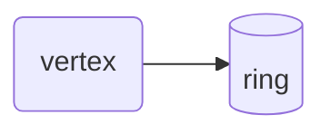

# Diagram vocabulary smoke page

This page draws every class of the site's diagram vocabulary, so a Mermaid upgrade or a
palette change that breaks the styling shows here first. Check it in the light and the
dark theme. The vocabulary itself, shapes and rules, is in the docs-article skill
(`.claude/skills/docs-article/SKILL.md`). The colours are defined once, in
`docs/_static/diagram-vocabulary.css`, and `tools/check_diagram_contrast.py` checks them.

A class goes on a node with `:::name` or a `class` line. Pages never add `style`,
`classDef` or `linkStyle` of their own.

## Wire and graph classes

```{mermaid}
:caption: "Legend: blue = frame, sky blue = record, green = vertex, orange = ring."
flowchart LR
    accTitle: Wire and graph classes
    accDescr: A frame carries a record, the record is written to a vertex, and the vertex owns a ring.
    F[/frame/]:::frame -->|carries| R[record]:::record
    R -->|write| V(vertex /a/b):::vertex
    V --- Q[(ring)]:::ring
```

## Application, peer and outside classes

```{mermaid}
:caption: "Legend: purple = application, vermillion = peer, grey dashed = not the library."
flowchart LR
    accTitle: Application, peer and outside classes
    accDescr: The application talks to a peer over a link that runs on the operating system's socket, which is not part of libtracer.
    A([application]):::app ==>|UDP| P[[peer]]:::peer
    P -.->|reply| A
    S[OS socket]:::notlib --- P
```

## A choice, unclassed

```{mermaid}
flowchart LR
    accTitle: A choice on one thing
    accDescr: A rhombus asks whether a record is packed; yes leads to one block, no to framed children.
    C{packed?} -->|yes| B[one block]
    C -->|no| K[framed children]
```

## A bare fence still renders

The block below is a plain `mermaid` fence, the spelling GitHub renders, kept on existing
pages and left alone by the lint.


